# DSO303 Assignment 2 - Online Exam Platform on AWS

## Summary

This is the AWS design for a university that is moving all exams and assignment uploads online. It has to handle 3,000 students starting one exam within 5 minutes and keep working if one Availability Zone goes down.

What I did:
- Designed the full architecture across 2 AZs (`architecture/`)
- Documented every service (`docs/services.md`)
- Built it in the Cloud Architecture Lab and simulated both walkthroughs and an AZ failure (`evidence/01` to `03`)
- Deployed a smaller working version on real AWS using Terraform and GitHub Actions (`evidence/04` to `11b`)
- Destroyed it after taking the evidence so it does not keep using the shared account (`evidence/12`)

| Folder | What is in it |
|---|---|
| `architecture/` | Diagram, the two walkthroughs, and how the design handles the exam peak and losing one AZ |
| `docs/services.md` | Service table |
| `evidence/` | Screenshots |
| `app/` | Flask API, React frontend and the notify Lambda |
| `infra/` | Terraform code. `infra/bootstrap/` is the one time setup |
| `.github/workflows/deploy.yml` | CI/CD pipeline |

The diagram shows the main request paths so it stays easy to read. Every connection, including the security group rules, is listed in the Connects to column of `docs/services.md`.

## Deploy steps

I used AWS CloudShell in `ap-south-1`. All my resources start with `tenzin-a2-`.

**1. One time setup**

```bash
cd infra/bootstrap
terraform init
terraform apply
```

This creates the S3 bucket for the Terraform state and the IAM role GitHub Actions uses to log in. Only the main branch of this repo can use the role, so no AWS keys are stored in GitHub. My account already had a GitHub OIDC provider. If yours does not, run `terraform apply -var create_oidc_provider=true` instead. The role is locked to my repo ID in `infra/bootstrap/main.tf`, so a fork would need to change that line.

**2. Add the role to GitHub**

Settings > Secrets and variables > Actions > Variables > add `AWS_DEPLOY_ROLE_ARN` with the `deploy_role_arn` output from step 1.

**3. Push to main**

When I push changes in `app/` or `infra/` to main, the pipeline:
1. logs in to AWS with OIDC
2. runs `terraform init` with the state bucket
3. creates the ECR repository if it is missing
4. builds the API image and pushes it to ECR
5. runs `terraform apply` with the new image tag, which creates or updates everything and redeploys ECS
6. waits for ECS to be stable
7. builds the React app, uploads it to S3 and clears the CloudFront cache
8. prints the site link

The first deploy took about 6 minutes.

## Tear down steps

```bash
cd infra
terraform init -backend-config="bucket=tenzin-a2-tfstate-<account id>"
terraform destroy
```

This deleted all 54 resources. I kept the bootstrap (state bucket and role) because it costs nothing.

## What I deployed compared with the design

The deployment covers everything the rubric asks for: frontend, API, two AZ database, S3 uploads and the async step. Some parts are smaller than the design:

| Design | Deployed | Reason |
|---|---|---|
| 1 NAT Gateway per AZ | 1 NAT Gateway | The shared account ran out of Elastic IPs |
| ALB on HTTPS with ACM | ALB on HTTP behind CloudFront HTTPS | No domain. Users still get HTTPS from CloudFront |
| Route 53, WAF, Cognito, SES, AWS Backup | Not deployed | No domain and to keep cost low |
| Assignments bucket with lifecycle, versioning and SSE-KMS | Private bucket with default encryption | The bucket is deleted at tear down, so 5 year rules could not be tested |
| Customer managed KMS key for S3, RDS, Secrets Manager and backups | AWS managed default keys | Easier to clean up in the shared account |
| Uploads limited to PDF or ZIP and 50 MB | 50 MB limit only | Demo only, the file type check is in the design |
| RDS backups 35 days, deletion protection on | Backups 1 day, deletion protection off | So `terraform destroy` can remove it |
| Secrets Manager rotation every 30 days | Secret only, no rotation | The demo only ran for a few hours |
| CloudWatch alarms | CloudWatch logs only | Demo only |
| Marking and notify queues with 2 Lambdas inside the VPC | Notify queue and 1 notify Lambda outside the VPC | The rubric needs one async step, and this Lambda only logs |
| 4 or more ECS tasks with scaling | 2 tasks, one per AZ | Demo only |

## Evidence

### Cloud Architecture Lab

Walkthrough 1: the autosave request goes through Route 53, WAF, CloudFront, the ALB, ECS and RDS and returns HTTP 200.

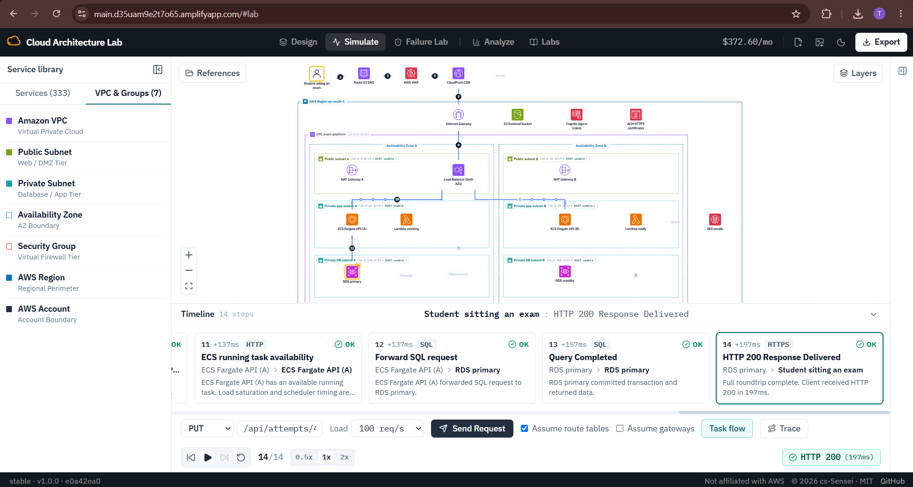

Walkthrough 2: the file goes straight to S3, then SQS, then the notify Lambda. HTTP 202.

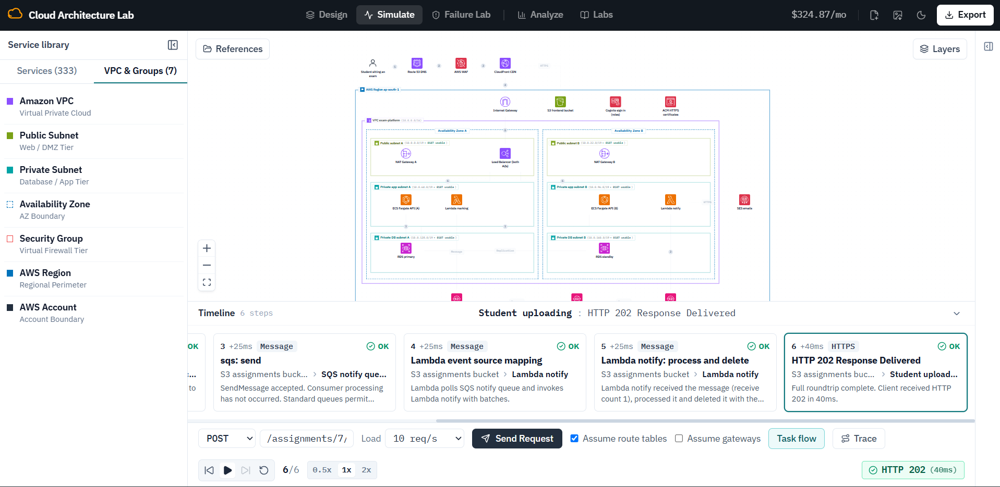

I turned off AZ A. Three resources in AZ A failed.

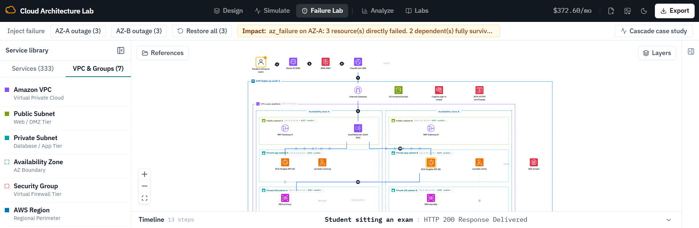

With AZ A down, the request still worked. It went to ECS in AZ B and RDS switched to the standby.

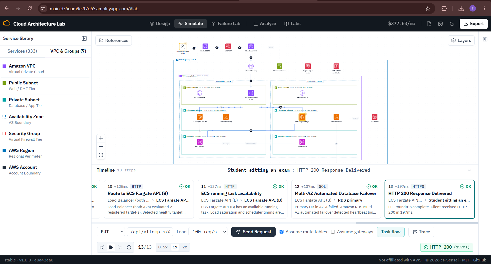

### Setup

The one time setup created the state bucket and the deploy role.

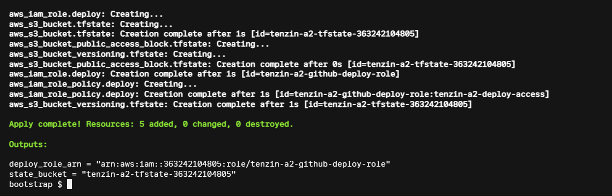

### Real deployment

The pipeline deployed everything after I pushed to main.

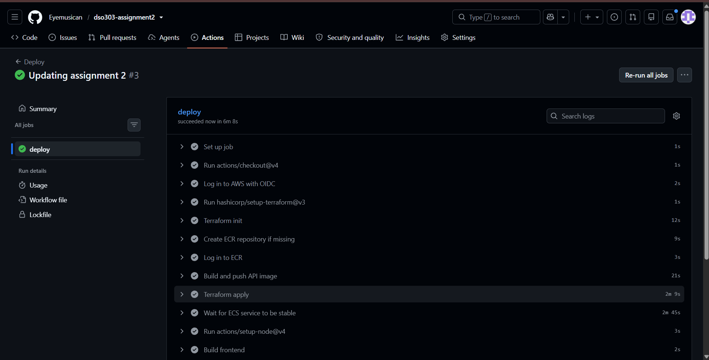

I started an exam on the live site and my answer autosaved after 30 seconds.

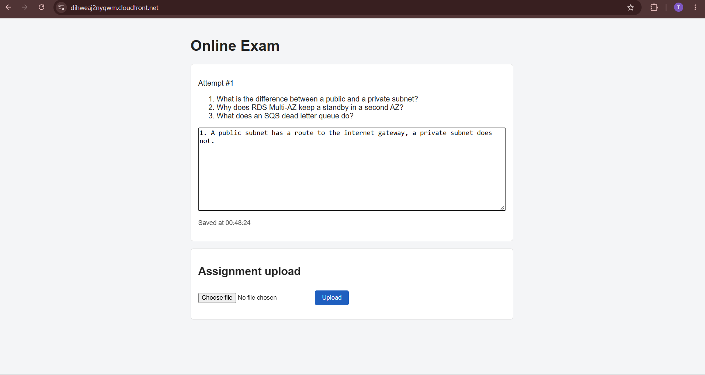

The API returns the saved answer from RDS, so the autosave really reached the database.

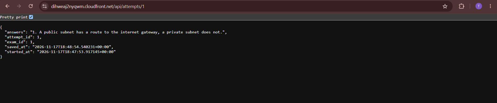

I uploaded a PDF. It went straight to the S3 bucket, not through the API.

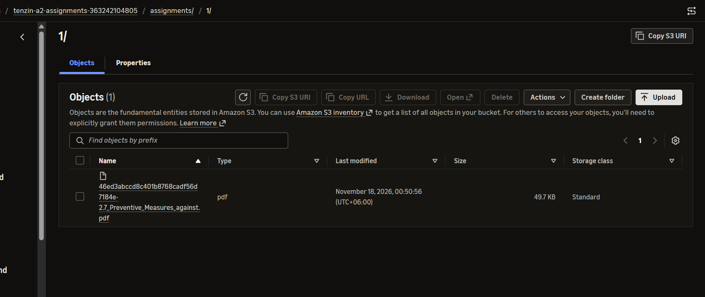

The notify Lambda logged "tutor notified" about a second after the upload.

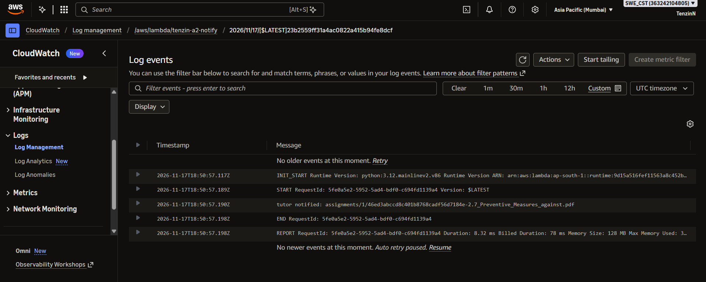

RDS is Multi-AZ, with the standby in `ap-south-1a`.

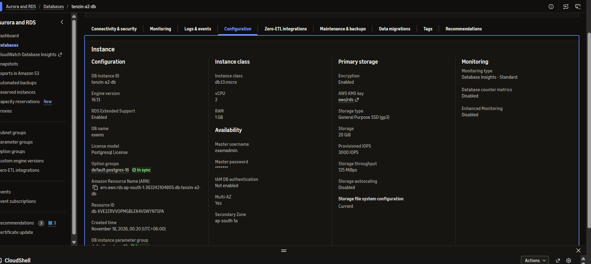

The primary is in `ap-south-1b`, and only the ECS security group can connect to it.

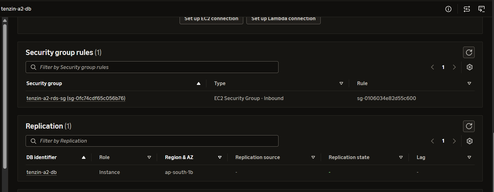

### Push to main redeploys

Runs 1 and 2 failed (problems below), run 3 was the first full deploy, and run 4 started by itself when I pushed a small change.

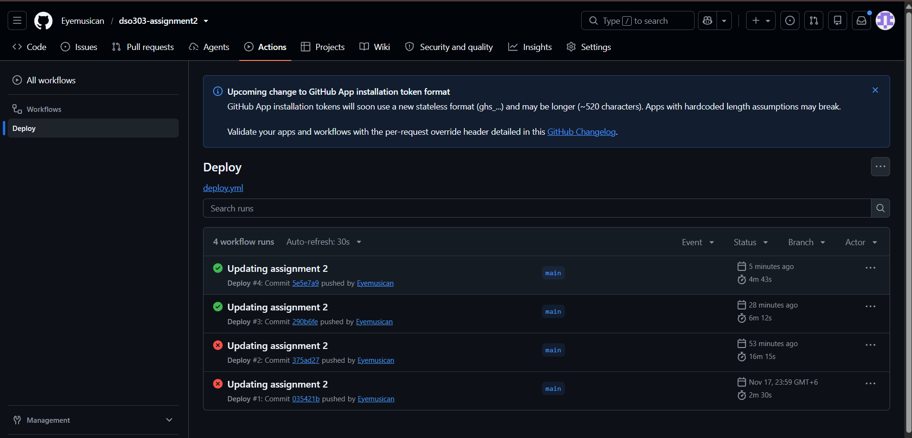

After run 4 the site showed the new heading "Online Exam - CST".

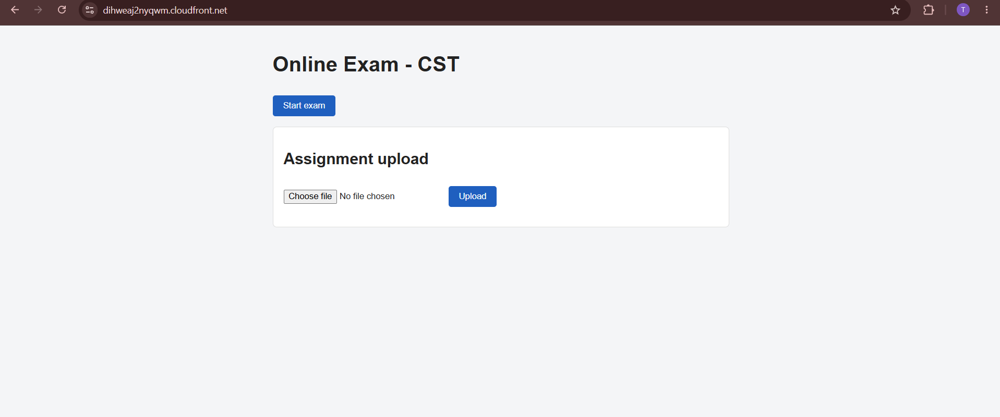

### Tear down

All 54 resources were deleted.

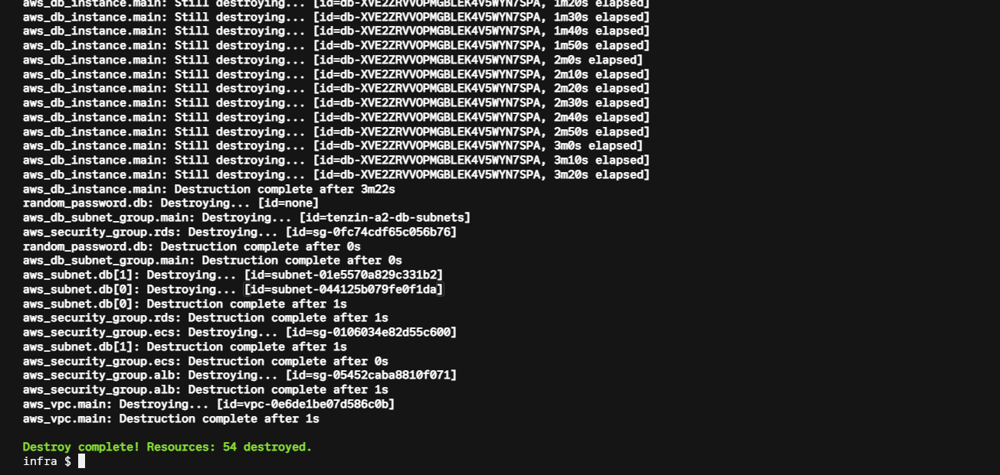

## Problems I faced

**1. GitHub could not log in to AWS.** Run 1 failed with "Not authorized to perform sts:AssumeRoleWithWebIdentity".

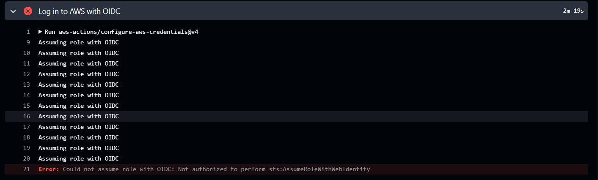

CloudTrail showed that GitHub now adds number IDs to the repo name it sends, so it did not match my role.

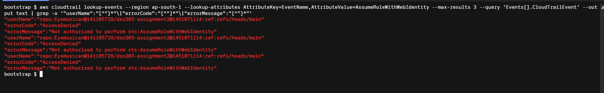

I updated the role to the new format. It is still limited to this repo and the main branch.

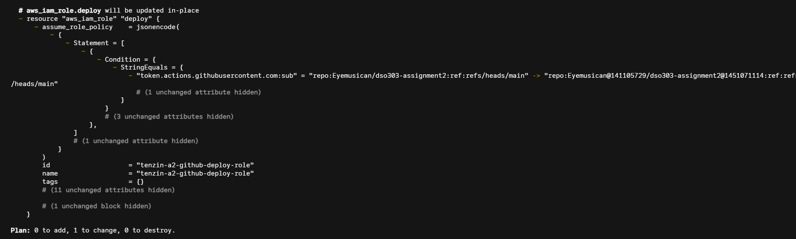

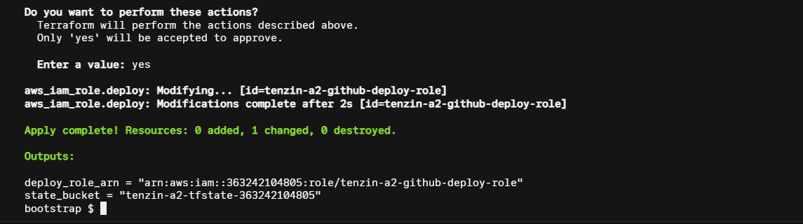

**2. No Elastic IPs left and a missing permission.** Run 2 failed because the shared account had no Elastic IPs left for the second NAT Gateway, and the deploy role was missing `lambda:ListTags`. I added the permission and changed the deployment to 1 NAT Gateway. Run 3 then worked.

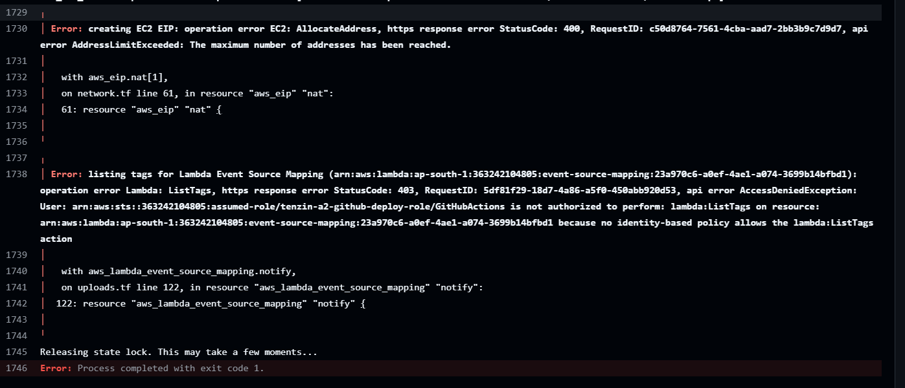

